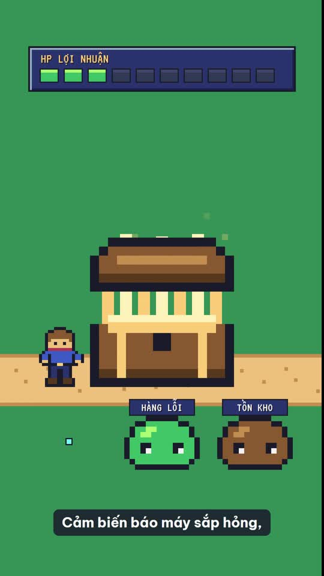

# VideoMotion: AI làm đạo diễn cho video

Trang giới thiệu, video mẫu và thư viện 92 style (bấm "Chép" để lấy `style <tên>`): **https://andyluu98.github.io/VideoMotion/**

Plugin Claude Code làm video tiếng Việt từ một câu yêu cầu. Không khung dựng sẵn: AI nghĩ ý tưởng lớn, viết kịch bản, đọc bằng giọng VieNeu, phân cảnh theo từng từ, rồi giao mỗi cảnh cho một agent Sonnet dựng song song bằng HyperFrames và GSAP. Ra file MP4 có nhạc nền và phụ đề.

```
/videomotion Làm video 45 giây giải thích lãng phí trong sản xuất, style pixel-rpg
```

## Video mẫu

[](site/media/san-quai-lang-phi.mp4)

"Săn quái lãng phí trong xưởng": 24 giây, khung dọc 9:16, style `pixel-rpg`, giọng Ngọc Huyền. 4 cảnh do 4 agent Sonnet dựng song song. Mã nguồn dự án ở `examples/san-quai-lang-phi/` (bấm ảnh để xem video).

Anh em với [SlideMotion](https://github.com/andyluu98/slidemotion) (làm slide): dùng chung 92 thẻ style (VideoMotion có thêm 6 thẻ riêng) và cùng một tinh thần.

## Vì sao có VideoMotion

[MotionFly](https://github.com/andyluu98/MotionFly) làm video trọn gói tốt, nhưng khung quá chặt: hạn mức chữ và hình cố định, thẻ style dài với nhiều luật kỹ thuật, nhiều vòng chấm và duyệt. Kết quả là video nào cũng một dáng, kể cả khi chạy bằng Codex hay Antigravity.

| | MotionFly | VideoMotion |
|---|---|---|
| Cách nghĩ | Luật hình cứng: 85 phần trăm hình, tối đa 30 từ mỗi cảnh, thẻ nào cũng có SVG | Ý tưởng lớn, vật xuyên suốt, chuyển động theo động từ của câu; bố cục do người dựng tự nghĩ |
| Style | 43 thẻ tiếng Anh, dài, nhiều luật kỹ thuật | 92 thẻ tiếng Việt ngắn (86 chung với SlideMotion): gu, màu, chữ, chữ ký chuyển động |
| Phông chữ | Chỉ Be Vietnam Pro và JetBrains Mono | Phông riêng của từng style, tải sẵn bằng `tools/fonts.py` |
| GSAP | Chỉ bản lõi | Thêm SplitText, DrawSVG, MotionPath, MorphSVG, ScrambleText, CustomEase |
| Agent dựng cảnh | Theo model phiên chính | `model: sonnet` (luôn là Sonnet mới nhất), `effort: medium`, chạy song song |
| Kiểm và duyệt | 3 cổng duyệt, tờ duyệt, agent người chấm, sửa tối đa 2 vòng | 1 cổng duyệt kịch bản (bỏ được), kiểm kỹ thuật `hyperframes check`, kiểm file MP4 một lần |

Phần máy (giọng, mốc từng từ, nhạc, ghép, render, phụ đề) giữ nguyên từ MotionFly vì đang chạy tốt.

## Quy trình

| Bước | Việc | Ra file |
|---|---|---|
| 1 | Brief: chủ đề, khán giả, khung, độ dài, giọng | `brief.json` |
| 2 | Chọn style: hợp, khác nền, bất ngờ | |
| 3 | Ý tưởng lớn và kịch bản (cổng duyệt duy nhất) | `script.json` |
| 4 | Giọng VieNeu, mốc thời gian từng từ | `voice.wav`, `words.json` |
| 5 | Phân cảnh neo theo từ khóa lời đọc | `storyboard.json`, `timeline.json` |
| 6 | Nhạc nền tự hạ khi có lời, -14 LUFS | `mix.wav` |
| 7 | Phông, màu, agent Sonnet dựng từng cảnh song song, kiểm tra, render, phụ đề | `compositions/`, `renders/*.mp4`, `phude.srt` |

Nói "tự làm hết" để bỏ cổng duyệt kịch bản.

## Cài đặt

Cần: [Claude Code](https://claude.com/claude-code), [Node.js](https://nodejs.org) 22 trở lên, Python 3.10 trở lên, [ffmpeg](https://ffmpeg.org/download.html) trong PATH. Nên có [uv](https://docs.astral.sh/uv/).

```
/plugin marketplace add andyluu98/VideoMotion
/plugin install videomotion@videomotion
/vm-cai-dat
```

VideoMotion dùng chung môi trường Python và model với MotionFly ở `~/.motionfly`. Máy đã chạy MotionFly thì không tải lại gì; máy mới thì `/vm-cai-dat` tải khoảng 2 đến 3 GB (giọng VieNeu, Whisper).

**Codex, Antigravity và công cụ khác:** đọc `skills/videomotion/SKILL.md` làm hướng dẫn chính. Công cụ không có agent con thì tự dựng lần lượt từng cảnh theo `agents/vm-canh.md`.

## Cấu trúc

```
skills/videomotion/   đạo diễn: brief, style, ý tưởng lớn, kịch bản, phân cảnh
skills/vm-dung/       phông, màu, giao cảnh song song, kiểm tra, render, ghép âm
skills/vm-giong/      giọng VieNeu, mốc từng từ
skills/vm-nhac/       nhạc nền, trộn -14 LUFS
skills/vm-cai-dat/    kiểm tra và cài đặt
agents/vm-canh.md     agent dựng một cảnh (Sonnet, effort medium)
styles/               92 thẻ style, INDEX.md, nhip-video.md (dùng thẻ slide cho video)
motion/dong-tu.md     từ điển động từ ra chuyển động GSAP
tools/                voice, timeline, fonts, packets, assemble, audio, music, setup
templates/            khuôn cảnh, phông mặc định
```

## Giấy phép

Mã và tài liệu: MIT (`LICENSE`). GSAP tải từ CDN theo giấy phép riêng của GSAP; phông theo giấy phép của từng phông; thành phần chép từ dự án khác ghi trong `NOTICE.md`.
